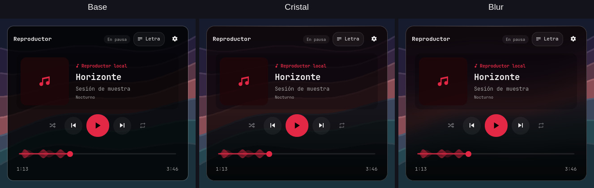
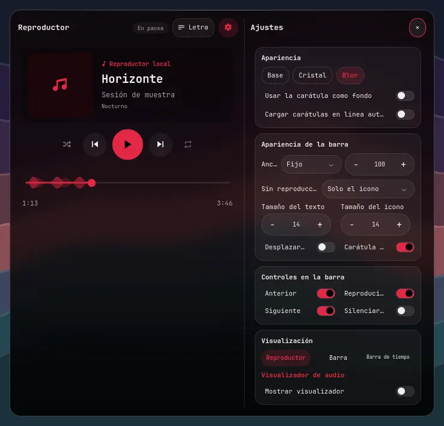

# ElMeGGa OmaPlayer

Now-playing widget for the Omarchy shell, with playback controls, live audio visualizers, and optional synced lyrics.



*Panels rendered from the plugin with sample data and the Rubí OLED palette. The background blur is simulated in the preview.*

## English

OmaPlayer shows the active media source, track information, cover art, and playback controls in the bar and an expandable panel. The bar, player panel, and timeline have independent visualizer settings. The panel follows the active Omarchy theme and offers Base, Glass, and Blur finishes. The interface is available in English and Spanish.

### Features

- Choose an MPRIS player automatically or select a source. See the track, artist, album, artwork and any extra metadata shared by the app.
- Control previous, play/pause, next, shuffle and repeat, and seek in the timeline when the player supports those controls.
- Customize bar controls, artwork, title width and scrolling, icon and text sizes, and the space reserved when playback stops.
- Configure audio visualizers independently for the bar, player panel and timeline. Available styles include bars, waves and dots, with size, speed and mirroring options where applicable.
- Show synchronized lyrics through LRCLIB and optionally use the cover as the panel background.

### Install and enable

Compatible with the Omarchy Quattro shell. Tested on Omarchy 4.5.0-3.

```sh
omarchy plugin add https://github.com/megga-ernesto/omaplayer.git --enable
```

Click the music icon, track title, or visualizer in the bar to open the player. Use the gear to open settings. Use **Lyrics** to look up synchronized lyrics.

### Dependencies and data

- Omarchy's Quickshell, Hyprland, and an app that exposes an MPRIS playback session provide the panel and media controls. Available commands depend on the media app.
- Python 3 runs the optional helpers. The audio visualizers use `parec` (from Arch's `libpulse` package) to read the default output monitor locally. The helper sends visualization data to the widget and saves no recording.
- Lyrics use `curl` to query [LRCLIB](https://lrclib.net/docs) over HTTPS when **Lyrics** is enabled and the panel is open. The request contains the available title, artist, album, and duration. Online artwork for supported services uses `curl` when requested from the panel. OmaPlayer automatically fetches cover art from those fixed HTTPS sources when the displayed track changes. Turn off **Load online covers automatically** to load covers manually.

### Appearance

Choose a finish in **Settings → Appearance**.

| Finish | Appearance |
|---|---|
| **Base** | Uses the active Omarchy popup colors, transparency and compositor rules. |
| **Glass** | Adds a translucent vertical gradient using 6%, 3% and 0% of the theme accent from top to bottom. |
| **Blur** | Uses the Glass gradient and asks Hyprland to soften the wallpaper and windows behind the panel. |

If Hyprland cannot apply Blur, the panel displays Glass and explains why in Appearance. Cover artwork as a backdrop has its own setting.



### Update or uninstall

```sh
omarchy plugin update elmegga.omaplayer
```

To disable or remove the widget:

```sh
omarchy plugin disable elmegga.omaplayer
omarchy plugin remove elmegga.omaplayer
```

If you installed the Lua rule for an earlier release, remove the `require("hypr.omaplayer")` line and the `~/.config/hypr/omaplayer.lua` file, then run `hyprctl reload` and `hyprctl configerrors`.

## Español

OmaPlayer muestra la carátula, los datos de la pista y los controles en la barra y en un panel desplegable. Los visualizadores de la barra, el reproductor y la barra de tiempo se configuran por separado. La interfaz sigue el tema activo de Omarchy.

### Funciones

- Selección automática o manual del reproductor MPRIS, metadatos y carátula de la pista.
- Controles de reproducción, avance y retroceso, navegación en la línea de tiempo, reproducción aleatoria y repetición según la aplicación.
- Ajustes de controles, carátula, ancho y desplazamiento del título, tamaños y espacio reservado en la barra cuando no hay reproducción.
- Visualizadores independientes en barra, panel y línea de tiempo, con barras, ondas, puntos y ajustes según el estilo.
- Letra sincronizada con LRCLIB y carátula como fondo opcional.

### Instalar y usar

```sh
omarchy plugin add https://github.com/megga-ernesto/omaplayer.git --enable
```

Abre el panel pulsando el icono de música, el título o el visualizador. Usa el engranaje para abrir los ajustes. La opción **Letra** consulta LRCLIB solo cuando está activada y el panel está abierto.

Los controles dependen de los datos que comparta la aplicación mediante MPRIS. Las funciones opcionales usan Python 3, `parec` (paquete `libpulse` en Arch) para el visualizador y `curl` para letras o carátulas en línea. El visualizador procesa la salida de audio local y no guarda grabaciones. Las carátulas de servicios compatibles se cargan automáticamente. Puedes apagar **Cargar carátulas en línea automáticamente** para cargarlas a mano.

En **Ajustes → Apariencia** elige **Base**, **Cristal** o **Blur**. Base adopta el tema de Omarchy, incluidas sus reglas de composición. Cristal usa el fondo traslúcido de los paneles del tema activo con un toque de su color de énfasis. Blur difumina el escritorio tras el panel cuando Hyprland tiene el efecto habilitado. Si el efecto falla, el panel muestra Cristal y un aviso en Apariencia. La carátula como fondo se controla por separado.

### Actualizar o quitar

```sh
omarchy plugin update elmegga.omaplayer
```

Para desactivar o quitar el widget:

```sh
omarchy plugin disable elmegga.omaplayer
omarchy plugin remove elmegga.omaplayer
```

Si instalaste la regla Lua de una versión anterior, quita la línea `require("hypr.omaplayer")` y el archivo `~/.config/hypr/omaplayer.lua`. Ejecuta `hyprctl reload` y `hyprctl configerrors`.

## License

Plugin source code is available under the [MIT License](LICENSE).
